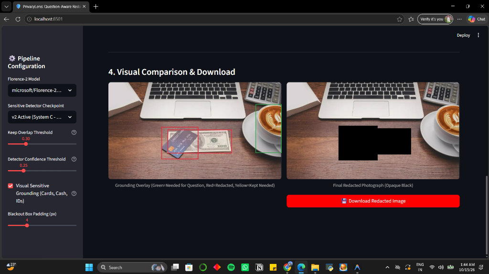


# PrivacyLens: Task-Aware Visual Privacy Protection with Human-in-the-Loop Redaction

[](https://www.python.org/downloads/)
[](https://pytorch.org/)
[](https://opensource.org/licenses/MIT)
[](https://streamlit.io/)

**PrivacyLens** is an intelligent, task-aware visual privacy redaction pipeline designed to protect user privacy in visual question answering (VQA) and assistive vision systems, including applications for people who are blind or have low vision.

Rather than blindly blurring entire images or discarding sensitive content essential to answering user inquiries, PrivacyLens combines **vision-language open-vocabulary grounding (Microsoft Florence-2)**, **custom fine-tuned object detection (Faster R-CNN)**, **OCR extraction**, and **task-aware query analysis**.

It dynamically preserves information needed to answer the user's question while redacting unnecessary private, personal, or financial information, such as credit cards, cash, identity cards, sensitive documents, and personal details.

---

### Visual Comparison & Output Demo

The following demonstration illustrates question-aware privacy redaction using the PrivacyLens Streamlit dashboard.

<div align="center">
  
</div>

**Left — Grounding Overlay**
- 🟩 **Green boxes:** Content preserved because it is relevant to the user's query. For example, when asked "What is in the cup?", the coffee cup is retained.
- 🟥 **Red boxes:** Unnecessary sensitive objects identified for redaction, such as credit cards and cash.

**Right — Final Redacted Image**
- Black bounding boxes cover private items while preserving the remaining image context for downstream visual reasoning.

---

### Key Features

- **Task-Aware Selective Redaction:** Uses question semantics to distinguish privacy-sensitive content from task-essential visual context, balancing privacy and utility.
- **Multi-Model Grounding and Detection:**
  - **Florence-2:** Vision-language phrase grounding and open-vocabulary localization of sensitive items and query-relevant objects.
  - **Fine-Tuned Faster R-CNN:** Detects domain-specific sensitive objects, including credit cards, currency, identification cards, and documents.
  - **OCR and Text Recognition:** Identifies potentially sensitive textual information, such as names, numbers, addresses, and account details.
- **Keep/Redact Overlap Logic:** Uses intersection over union (IoU) and containment between query-critical regions and sensitive detections to reduce accidental redaction of relevant subjects.
- **Interactive Streamlit Dashboard:** Supports human-in-the-loop inspection, configurable confidence thresholds, keep-overlap ratios, blackout padding, and redacted image downloads.

---

### Dataset Details

PrivacyLens uses the **VizWiz-Priv** dataset for privacy-aware visual reasoning and evaluation.

- **Origin:** Real-world photographs captured by people who are blind, paired with spoken questions.
- **Privacy Annotations:** Bounding boxes identify sensitive content across categories such as financial information, identification, personal mail, private screens, and medical data.
- **Annotation Splits:** The official `train.json` and `val.json` annotation files are expected under `data/raw/Annotations/Annotations/`.
- **On-Demand Image Caching:** A range-request streaming downloader and local cache manager (`src/data/dataset_cache.py`) help download and cache only the images required for local experiments.

---

### Model & Training Pipeline

#### Architectures

- **System C — Active Detector:** Faster R-CNN with a ResNet-50-FPN-v2 or MobileNetV3-Large-FPN backbone and custom anchor generation optimized for the aspect ratios and scales of sensitive regions in VizWiz-Priv.
- **System B — Baseline:** A pretrained COCO detector used as a baseline, with classification and regression heads fine-tuned as configured by the experiment.
- **Vision-Language Pipeline:** Microsoft Florence-2 (`microsoft/Florence-2-base` or `microsoft/Florence-2-large`) for question-aware grounding and open-vocabulary phrase localization.

#### Training Configuration

- **Loss Function:** Multi-task Faster R-CNN loss combining classification and bounding-box regression.
- **Optimization:** SGD with momentum (0.9) or AdamW, with cosine annealing or step-based learning-rate scheduling, depending on the experiment configuration.
- **Evaluation Metrics:** COCO mean Average Precision (mAP@0.50 and mAP@0.50:0.95), IoU-based analysis, and sensitive-object recall.

---

### Repository Structure

```text
PrivacyLens/
├── docs/
│   └── images/
│       └── demo_redaction_comparison.png  # Dashboard demonstration
├── data/
│   └── raw/
│       └── Annotations/                   # VizWiz-Priv annotations
├── notebooks/
│   └── privacylens_training.ipynb         # Training and research notebook
├── scripts/
│   ├── download_images.py                 # Image download and caching
│   ├── run_baseline.py                    # Baseline evaluation
│   └── run_training.py                    # Model fine-tuning
├── src/
│   ├── data/                              # Dataset loaders and caching
│   ├── models/                            # Detection architectures and training
│   ├── pipeline/                          # Grounding, OCR, and redaction
│   ├── evaluation/                        # Metrics and visualization
│   └── ui/
│       └── app.py                         # Streamlit dashboard
├── tests/                                 # Unit and integration tests
├── download_annotations.py                # Annotation download script
└── requirements.txt                       # Project dependencies
```

*Note: The tree above documents the expected layout. Keep it synchronized with the actual files and directories in your repository.*

---

### Getting Started

#### 1. Clone the Repository

```bash
git clone https://github.com/jui1ee/PrivacyLens.git
cd PrivacyLens
```

#### 2. Set Up the Environment

Create and activate a virtual environment, then install the dependencies.

```bash
# Create a virtual environment
python3 -m venv venv

# Activate it on Linux or macOS
source venv/bin/activate

# On Windows PowerShell, use:
# .\venv\Scripts\Activate.ps1

# Install dependencies
pip install -r requirements.txt
```

#### 3. Download Annotations and Images

Download and extract the VizWiz-Priv annotations.

```bash
python download_annotations.py
```

To download or cache images for training and evaluation:

```bash
python -m scripts.download_images
```

#### 4. Run the Interactive Streamlit Dashboard

Launch the PrivacyLens dashboard.

```bash
streamlit run src/ui/app.py
```

Open [http://localhost:8501](http://localhost:8501) in your browser to upload images, adjust detector thresholds, inspect bounding-box overlays, and download redacted results.

#### 5. Run Training and Experiments

To train the custom sensitive-object detector (System C):

```bash
python -m scripts.run_training --system C
```

To execute the research notebook programmatically:

```bash
jupyter nbconvert --to notebook --execute --inplace notebooks/privacylens_training.ipynb
```

